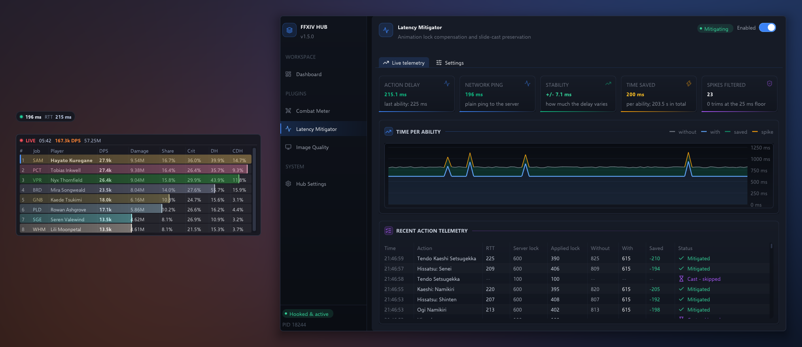
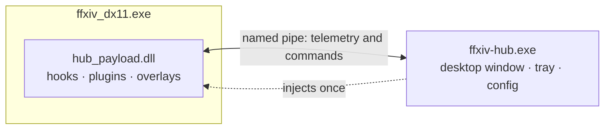

# FFXIV Hub

[](https://github.com/mgauna-ar/ffxiv-hub/actions/workflows/ci.yml)


[](LICENSE)

**A combat meter, a latency mitigator and a DLSS fix for Final Fantasy XIV, in one app
with in-game overlays.** Two files, no installer.



[What's inside](#-whats-inside) · [Quick start](#-quick-start) · [Controls](#-controls) ·
[Safety](#-safety-and-fair-play) · [FAQ](#-troubleshooting-and-faq) ·
[Configuration](#-configuration) · [Building](#-building-from-source)

---

## ✨ What's inside

| Plugin | What it does |
|---|---|
| [⚔️ **Combat Meter**](plugins/combat_meter/README.md) | DPS without overkill or downtime, HPS without overheal, and rDPS/aDPS/nDPS/cDPS from raid buff credit. Pets merged into their owners, deaths with a recap, buff/debuff/DoT uptime, damage taken, casts and GCD uptime, a per-second timeline, and a pull history with the boss's HP left. |
| [⚡ **Latency Mitigator**](plugins/latency_mitigator/README.md) | Trims the animation lock by your measured round trip, so oGCDs weave on a high ping as they would next to the data center. Nothing to tune. Adds an in-game ping and RTT badge. |
| [🖼️ **Image Quality**](plugins/image_quality/README.md) | Holds DLSS at the mode you pick, from DLAA to Performance, instead of letting it move with GPU load, and moves the camera by the jitter DLSS is told about, so still edges stop looking jagged. Changes nothing under FSR. |

Overlays are drawn onto the game's own frame and can be moved, scaled, faded, locked,
made click-through, or hidden in certain situations. The desktop window holds the
details, and the tray icon shows whether the Hub is attached. Every plugin has a master
switch: off, it hooks nothing, streams nothing, draws nothing and leaves no setting
changed. Settings save as you change them, and new versions install in one click.

---

## 📋 Requirements

- Windows 10 or 11, 64-bit.
- Final Fantasy XIV: Dawntrail (7.x), DirectX 11 client (`ffxiv_dx11.exe`).
- Administrator rights ([why](#2-run-it-as-administrator)).

---

## 🚀 Quick start

### 1. Download and extract

Grab `ffxiv-hub-windows-x64.zip` from [Releases](../../releases) and extract it anywhere.
Keep `ffxiv-hub.exe` and `hub_payload.dll` in the same folder.

### 2. Run it as administrator

Right-click `ffxiv-hub.exe` → **Run as administrator**. Loading the payload into the game
needs elevation; without it the Hub never attaches and the dashboard says *"Injection was
refused."* The binaries are not code-signed, so Windows may warn you the first time
([what to do](#-troubleshooting-and-faq)).

### 3. Launch Final Fantasy XIV

Start the game as usual. The Hub injects its payload once the game window is up. Closing
the game puts the Hub back to waiting; closing the Hub leaves the game running and hides
the overlays until you start it again.

### 4. Check it worked

The sidebar reads **Hooked & active**, and the combat meter and ping badge appear in
game. The meter fills once you fight, the badge's RTT after your first ability. If not,
the sidebar badge says why (hover it for the full line):

| Badge | Means |
|---|---|
| Searching for game | The game is not running, or its window is not up yet. |
| Injecting · Connecting | The payload is loading, or has not answered yet. |
| Hooks missing | The payload could not hook the game, usually after a patch. |
| Reconnecting | The connection dropped. The payload retries every 2 seconds. |
| Unloaded | You used **Unload payload** in this game session. Restart the game. |
| Access denied | Run the Hub as administrator. |

---

## 🎮 Controls

- **Drag** an unlocked overlay to move it. The combat meter also resizes from its edges.
- **Right mouse always reaches the game**, even over an overlay, so the camera never
  catches on one.
- Each overlay is set up under its plugin's **Settings → In-game overlay**: shown or
  hidden, locked, click-through, opacity, scale, and when to hide. Hide conditions (only
  in or out of combat, only in duties, not in cutscenes, loading screens or menus) apply
  only while the overlay is locked, so an unlocked one can always be found. One shown
  only in combat stays up 5 seconds after combat ends by default.
- The **desktop window** has a Dashboard, a page per plugin ending in a Settings tab, and
  Hub Settings. The **tray icon** opens it on click, shows the connection on hover, and
  offers Start with Windows, the logs folder, the config file and Exit on right-click.

---

## 🔒 Safety and fair play

FFXIV Hub runs entirely on your PC and stays within what the server already allows.

- **Reads** combat results as the game receives them, and the names, jobs, HP and status
  effects of your party and the enemies you fight. The Combat Meter only ever reads.
- **Writes** two things, locally:
  - Your animation-lock timer, after the server has confirmed the action. Never below a
    25 ms floor, and never for cast locks, rejected actions or locks over 2.5 s. *Dry-run
    mode*, or switching off *Enable animation lock mitigation*, stops it.
  - Three graphics settings, only under DLSS: whether the render resolution follows GPU
    load, the resolution, and the camera jitter. Switching Image Quality off gives them
    back.
- **Never** modifies, sends or delays network packets, automates input, or changes
  cooldowns or the GCD.
- **Network traffic** is an ICMP ping to your game server (or, when that fails, your data
  center's lobby), and one request to GitHub at startup for a newer release, which sends
  only the Hub's version. *Check for updates at startup* turns that off. Nothing about
  you or your play leaves your PC.
- **Closed, it goes quiet.** The overlays hide, mitigation stops and the graphics
  settings go back to the game's. The combat meter keeps counting in the background.

**Keep it to yourself.** Square Enix takes action when a third-party tool is brought up
in game or used against other players. Don't mention it in chat, and never use its
numbers to call anyone out.

---

## ❓ Troubleshooting and FAQ

<details>
<summary><b>Windows Defender or SmartScreen flags the download</b></summary>

<br>

Expected, and safe to allow. The Hub loads its payload the way a debugger attaches
(`VirtualAllocEx` and `CreateRemoteThread`), which antivirus heuristics flag in any
binary without an Extended Validation certificate. Click **More info → Run anyway**, or
[build it yourself](#-building-from-source).

</details>

<details>
<summary><b>It never attaches to the game</b></summary>

<br>

Run the Hub as administrator ([step 2](#2-run-it-as-administrator)), even if the game
isn't. When that is the cause, the dashboard says *"Injection was refused."* If it reads
*Payload unloaded*, restart the game.

</details>

<details>
<summary><b>The overlays are not showing up</b></summary>

<br>

Check, in order: you are logged in to a character (nothing draws on the title screen or
character select), the plugin's master switch is on, the overlay is on under **Settings →
In-game overlay**, and its hide conditions.

</details>

<details>
<summary><b>An overlay won't hide, or gets in the way of my clicks</b></summary>

<br>

Hide conditions apply only while the overlay is locked, so lock it. *Click-through mode*
passes every click to the game.

</details>

<details>
<summary><b>Where are the logs?</b></summary>

<br>

`%APPDATA%/ffxiv-hub/hub.log` (the app) and `hub_payload.log` (the payload), with the
previous run's kept as `*.prev.log`. Hub Settings shows `hub.log` live.

</details>

<details>
<summary><b>How do I stop it, or uninstall it?</b></summary>

<br>

Exit from the tray. The game keeps running and the payload goes dormant until the Hub
starts again. **Hub Settings → Unload payload** switches it off for the rest of the game
session. Either way the DLL stays loaded until the game closes, since pulling code out
from under a running DirectX pipeline is riskier than leaving it idle.

To uninstall, delete the folder, and `%APPDATA%/ffxiv-hub/` for the settings.

</details>

<details>
<summary><b>How do I update?</b></summary>

<br>

When a release is out, a notification says so and the sidebar shows **Update
available**. Click **Update & restart** in **Hub Settings → Updates**: the Hub downloads
it, checks it against the SHA-256 GitHub publishes, swaps its two files and restarts.

- The session's pull history is cleared.
- The game's payload stays on the old version until the game restarts.
- The replaced files stay as `*.old` until a later start can delete them.
- If the folder isn't writable, run as administrator, or replace both files by hand
  from [Releases](../../releases).

</details>

<details>
<summary><b>Final Fantasy XIV just patched and it stopped working</b></summary>

<br>

A patch can move what the Hub hooks. It then leaves the game unhooked and reads **Hooks
missing** until an updated release is out, which the Hub will tell you about.

</details>

<details>
<summary><b>The ping reads N/A, or I play through a gaming VPN</b></summary>

<br>

A VPN can hide the game's server connection. The Hub then pings your data center's lobby
instead, which needs it attached and a character in the world. The *Network ping:* line
in `hub.log` says what was pinged and what answered.

</details>

<details>
<summary><b>Why is the RTT higher than my ping? Should I raise the target ping?</b></summary>

<br>

They measure different things, and no. See the
[Latency Mitigator FAQ](plugins/latency_mitigator/README.md#faq).

</details>

---

## 🔧 Configuration

Everything is set from the desktop app and saved as you change it, to
`%APPDATA%/ffxiv-hub/config.json`: a `hub` section and one per plugin. The running game
also saves overlay state, such as a HUD you dragged, but only the plugin settings it
uses, so it never reverts a Hub setting. **Hub Settings → Reset all settings** restores
every default and switches every plugin back on.

| Key | Type | Default | Description |
|---|---|---|---|
| `start_with_windows` | bool | `false` | Launch automatically on Windows logon. |
| `minimize_to_tray` | bool | `true` | Closing the window hides it to the notification area instead of exiting. |
| `show_notifications` | bool | `true` | Windows notifications on attach and detach, and when a new version is out. |
| `check_for_updates` | bool | `true` | Ask GitHub for a newer release each time the Hub starts. |

Plugin keys are documented in [Combat Meter](plugins/combat_meter/README.md#configuration),
[Latency Mitigator](plugins/latency_mitigator/README.md#configuration) and
[Image Quality](plugins/image_quality/README.md#configuration).

---

## 🔬 Under the hood



One DLL installs one DirectX 11 hook, one window-procedure hook and one detour per hooked
game function, and hands each event to the plugins in a fixed order. The plugins run in
the game, so overlays need no round trip, and stream the same events to the app over a
named pipe only your Windows user can open. Game memory is touched only inside exception
guards, so a bad address after a patch fails safely. The analytics, timing math, IPC and
config are plain C++20 with no Windows headers, so the tests also run on macOS and Linux.

The runtime topology, and the invariants any change has to keep, are in
[AGENTS.md](AGENTS.md).

```
ffxiv-hub/
├── include/hub/                 Plugin interfaces and descriptors, the version, shared types,
│                                game offsets and signatures
├── src/common/                  IPC, config, signature scanning, OS integration, update
│                                archive and SHA-256, shared UI
├── src/payload/                 The injected DLL: hooks, overlay host, game memory readers
├── src/app/                     The desktop manager: app state, views, updater, entry point
├── plugins/<name>/              Combat Meter, Latency Mitigator and Image Quality
├── tests/                       Unit tests, runnable on Windows, macOS and Linux
└── tools/                       Table generators, signature checks, game-client inspection,
                                 README screenshots
```

---

## 🔨 Building from source

### Tests (macOS, Linux or Windows)

You need a C++20 compiler and GNU `make`. It uses `clang++`; `make CXX=g++` picks g++.

```bash
make         # unit tests, the desktop UI syntax check, and every header on its own
make tsan    # the suite under ThreadSanitizer
make asan    # the suite under AddressSanitizer + UndefinedBehaviorSanitizer
```

Builds are incremental under `build/`; `make clean` removes them. The sanitizers need
Clang's runtime (`libclang-rt-18-dev` on Ubuntu), and macOS has no LeakSanitizer.

### README screenshots (macOS or Linux)

The pictures in `docs/images/` are drawn by the app's and the overlays' own code into a
software rasterizer, over an invented raid night (`tools/screenshots/`), so they can be
redrawn without Windows or the game. You need zlib, `curl` and `shasum`:

```bash
make screenshots
```

The first run downloads Selawik, an openly licensed stand-in for Segoe UI, and checks its
SHA-256. To use Segoe UI itself, point `SHOTS_WINDOWS_DIR` at a folder whose `Fonts`
subfolder holds `segoeui.ttf`, `segoeuib.ttf` and `seguisb.ttf`. Another compiler or
platform can move a few antialiased pixels, so commit only the pictures a change alters.

### Windows binaries

You need Visual Studio 2022 with *Desktop development with C++*, and CMake 3.22+:

```cmd
cmake -B build -S . -A x64
cmake --build build --config Release
ctest --test-dir build -C Release --output-on-failure
cd build
cpack -G ZIP -C Release
```

The binaries land in `build/bin/Release/`, and `cpack` writes the same
`ffxiv-hub-windows-x64.zip` a release publishes. Warnings in the project's own code are
errors (`/W4 /WX`). CI builds and tests every push; a `v*.*.*` tag matching
`include/hub/version.hpp` publishes a release.

---

## 📚 Documentation

| Document | What it covers |
|---|---|
| Plugin READMEs: [Combat Meter](plugins/combat_meter/README.md) · [Latency Mitigator](plugins/latency_mitigator/README.md) · [Image Quality](plugins/image_quality/README.md) | How each plugin works, its overlay, view and settings |
| [AGENTS.md](AGENTS.md) | Architecture and the invariants every change must keep |
| Plugin AGENTS.md: [Combat Meter](plugins/combat_meter/AGENTS.md) · [Latency Mitigator](plugins/latency_mitigator/AGENTS.md) · [Image Quality](plugins/image_quality/AGENTS.md) | Plugin rules, and what was verified about the game client |
| [`.claude/skills/`](.claude/skills/) | After a game patch, inspecting the client, the ThreadSanitizer run, cutting a release |

---

## 📄 License

MIT. See [LICENSE](LICENSE).

Bundled third-party code:

- **Dear ImGui** (MIT), vendored under `src/third_party/imgui/`.
- **MinHook** (BSD-2-Clause), vendored under `src/third_party/minhook/`.
- **Lucide icons** (ISC). A subset is embedded in
  `src/common/include/common/ui/icons_font.inl`; regenerate it with
  `tools/embed_icon_font.py`.

FINAL FANTASY XIV © SQUARE ENIX CO., LTD. FINAL FANTASY is a registered trademark of
Square Enix Holdings Co., Ltd. FFXIV Hub is an independent project and is not affiliated
with or endorsed by Square Enix.
