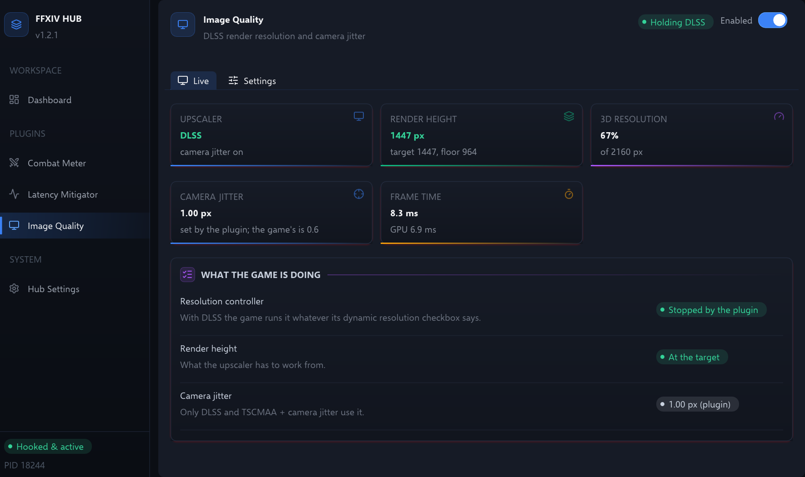

# 🖼️ Image Quality

Keeps DLSS rendering at the 3D resolution scale you chose, and gives it the camera jitter
it needs to smooth edges that are standing still. It changes nothing unless the game's
upscaler is DLSS, and hands every value back to the game when it is switched off.

Part of [FFXIV Hub](../../README.md). Enable or disable it from its page in the desktop
app, or from its card on the dashboard.

## At a glance

- **Fixed render resolution.** With DLSS the game lowers the resolution it renders at
  whenever the GPU is busy, then raises it again 9 pixels every half second. After a
  loading screen that can take half a minute. The plugin stops that, so DLSS always
  works from the resolution you set.
- **Full camera jitter.** DLSS smooths edges by nudging the camera a fraction of a pixel
  every frame. The game nudges it by 0.6 of a pixel, so edges that stay still never get
  sampled across the whole pixel and stay jagged. The plugin uses a full pixel.
- **Visible.** The desktop view shows the upscaler, the height the game renders at
  against its target, the jitter in use, and the game's frame and GPU times.
- **Reversible.** Switching it off, closing the Hub, or picking FSR puts the game's own
  values back within 50 ms.

---

## How it works

### What the game does with DLSS

The game's *3D resolution scaling* slider sets a target: the screen's height times the
scale. With DLSS selected, the game does not render at that target. It runs a resolution
controller, whatever the *Enable dynamic resolution* checkbox says:

- It renders anywhere between two thirds of the target and the target.
- It lowers the height when the GPU takes more than 90% of the frame, and raises it when
  it takes less than 80%.
- It moves 9 pixels at a time (18 above 1440), once every half second.

At 4K and a 67% scale that is 964 to 1447 pixels: 54 steps, about 27 seconds from the
bottom to the top. A busy GPU with no frame cap keeps it near the bottom, where DLSS
reconstructs 4K from 964 lines.

### What gets changed

Three values in the game's own render settings, from the payload, at most every 50 ms
and only when they differ from what the plugin wants:

| Setting | Game's value | With the plugin |
|---|---|---|
| The resolution controller | On | Off, under DLSS with *Fixed render resolution* |
| The height a frame renders at | Wherever the controller left it | The target, once the target has held for a tick |
| The camera jitter | 0.6 px | The *Jitter amount*, 1.0 px by default, under DLSS with *Full camera jitter* |

The plugin remembers the game's values before its first change and writes them back when
it lets go. The controller then resumes from the target and moves the height as before.

### What is left alone

- **FSR.** Nothing is changed while the upscaler is FSR, including *TSCMAA + camera
  jitter*, which keeps the game's jitter.
- **The scale itself.** The target is always the game's: changing the slider in game
  moves it, and the plugin follows.

---

## Desktop view

**Live** shows what the game reports now:

- **Upscaler**: under DLSS, that the camera jitter is on; under FSR, the edge smoothing
  setting.
- **Render height**: what the frame renders at, green at the target and amber below it,
  with the target and the floor.
- **3D resolution**: the scale, and the screen height it applies to.
- **Camera jitter**: the amount in use, and whether it is the plugin's or the game's.
- **Frame time**: the game's smoothed frame and GPU times, which its controller acts on.

Below them, *What the game is doing* says whether the controller is running or stopped,
whether the height is at the target, and whose jitter is in use.

**Settings** holds:

| Setting | What it does |
|---|---|
| Fixed render resolution | Under DLSS, stop the controller and render at the target. |
| Full camera jitter | Under DLSS, replace the game's 0.6 px jitter with *Jitter amount*. |
| Jitter amount | 0.5 to 1.5 px. 1.0 covers the whole pixel. |
| Reset to defaults | Both switches on, 1.0 px. |

---

## Configuration

Stored in the `image_quality` section of `%APPDATA%/ffxiv-hub/config.json`. Everything
here is editable from the plugin's page in the desktop app; the file is the persistence
format, not the intended interface.

| Key | Type | Default | Description |
|---|---|---|---|
| `plugin_enabled` | bool | `true` | Master switch. Off hands every value back to the game and streams nothing. |
| `fixed_dlss_resolution` | bool | `true` | Under DLSS, stop the resolution controller and render at the target height. |
| `override_dlss_jitter` | bool | `true` | Under DLSS, use `dlss_jitter_multiplier` instead of the game's jitter. |
| `dlss_jitter_multiplier` | float | `1.0` | Jitter amplitude in render pixels, `0.5`–`1.5`. |

---

## FAQ

<b>Will my frame rate drop?</b>

It can. If the controller was holding the height near its floor, DLSS now renders at the
full target instead, which is more work for the GPU. The Live tab shows both heights, so
you can see how far below the target the game was. Lower the *3D resolution scaling*
slider in game if you want the frame rate back.

<b>The Live tab says "Render settings not found".</b>

The payload could not find the game's render settings, usually after a game patch.
`hub_payload.log` names the one it missed. The plugin changes nothing until a release
fixes it.

<b>The page shows "Idle".</b>

The upscaler is not DLSS, so nothing is held. Pick NVIDIA DLSS in the game's graphics
settings.

